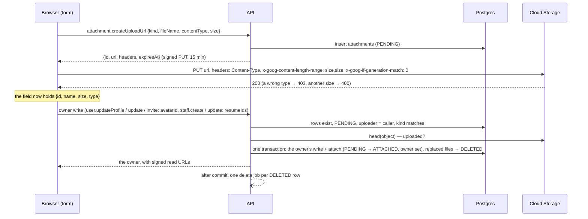

# How attachments work at runtime

What happens when someone picks a file, who may see it, and how the bucket is cleaned. Why it is
built this way: `adr/0012-attachments.md`. The accepted types, sizes, counts and bucket folders per
kind: `ATTACHMENT_RULES` in `packages/validation/src/attachment.schema.ts`. The delete job and the
sweeper as queue code: `../.claude/rules/queue.md` (Attachment deletes).

## The pieces

- **Bucket**: one private Google Cloud Storage bucket per environment (`d-round-dev` for
  development), uniform bucket-level access, public access prevention enforced. Objects are
  `<folder>/<random uuid><.ext>` (`avatars/…png`, `resumes/…pdf`); nothing is public, every read
  goes through a signed URL.
- **Rows**: `attachments` (`packages/database/prisma/schema/attachment/attachment.prisma`) — one row
  per object: kind, status, object key, original name, content type, size, uploader and the owner
  column (`user_id` for a プロフィール画像, `staff_id` for a 履歴書, `csv_import_id` for the file of
  a CSV import — ADR 0013).
- **Storage access**: `@repo/storage` (`packages/storage`): `createGcsStorage` signs V4 URLs locally
  from the service-account key (no request per URL), `head` and `delete` call the JSON API;
  `createMemoryStorage` replaces it in tests.
- **API**: `attachment.createUploadUrl` (`apps/api/src/modules/attachment/attachment.service.ts`)
  and the guards the owners' services call (`assertUploaded`, `syncAttachments`, `viewsOf`).
- **Worker**: `attachment-delete.processor.ts` and `attachment-sweeper.ts` in `apps/worker`.
- **Web**: `AvatarField` and `FileField` (`packages/ui`), `useAttachmentUpload(kind)`
  (`apps/web/hooks/use-attachment-upload.ts`) and `lib/attachments.ts`.

## Picking and saving a file



- The file is uploaded the moment it is picked; the form's save attaches it. Until then the field
  shows a spinner, and the form refuses to save a file still uploading
  ("アップロードが完了するまでお待ちください").
- `avatarId` / `resumeIds` left out of a write leave the files as they are; `avatarId: null` and a
  shorter `resumeIds` remove files.
- A rejected owner write (validation, conflict, rollback) attaches nothing: the uploads stay
  `PENDING` and expire. A user holds at most 20 unattached uploads at once.
- Two saves of one owner take turns (the owner's row is locked inside the save), so an owner never
  ends up with two avatars.

## Reading a file

There is no generic "read this file" procedure. The owner's read returns the files with signed GET
URLs valid for 15 minutes: `user.me` / `user.byId` (`avatar`), `staff.byId` (`resumes`). Whoever may
read the owner may read its files — the owner's ability check is the file's. The header treats
`user.me` as fresh for 10 minutes, so a page opened or a tab refocused later fetches new URLs before
the old ones expire. Read URLs name the file in `Content-Disposition` (`inline`, with the Japanese
name), so a PDF opens in the browser and saves under its own name.

## Who may upload

Every signed-in user may ask for an upload URL (`create Attachment`,
`.claude/rules/permissions.md`). A 履歴書 needs `create` or `update Staff` as well. Attaching is
decided by the owner's write: one's own プロフィール画像 through the self rule, someone else's
through `update User` (担当者情報編集) or `create User` (担当者追加), a staff's 履歴書 through the
staff write. A pending upload is attachable only by the user who uploaded it.

## How the bucket is cleaned

| Situation                                                             | What happens                                                                                                                                                                                             | When                                                                            |
| --------------------------------------------------------------------- | -------------------------------------------------------------------------------------------------------------------------------------------------------------------------------------------------------- | ------------------------------------------------------------------------------- |
| A file is replaced or removed and saved                               | its row becomes `DELETED` in the save's transaction; a job deletes the object, then the row, once the file's upload URL has expired (a still-valid URL could put the object back)                        | 16 min after the upload at the earliest; seconds after the save for older files |
| A file is uploaded but its form never saved                           | the sweeper turns the `PENDING` row `DELETED`; a later sweep enqueues its delete                                                                                                                         | 24 h to 24 h 40 min after the upload                                            |
| A delete job is lost or fails every attempt                           | the row stays `DELETED`; the sweeper enqueues it again (failed jobs are dropped at once)                                                                                                                 | every 15 min, after 10 min grace                                                |
| An object is already gone                                             | the delete counts as done (a missing bucket answers 404 too: the API and the worker check their bucket at start-up, before the worker takes any job, but a bucket deleted while they run is not noticed) | —                                                                               |
| The bucket refuses a delete (400 / 401 / 403: a key without the role) | the job fails at once; the row stays `DELETED`; each sweep tries again and alerts                                                                                                                        | until the configuration is fixed                                                |

The sweeper runs in the worker every 15 minutes (BullMQ job scheduler `attachment-sweeper`, 200 rows
per sweep). The bucket keeps deleted objects for 7 days (Cloud Storage soft delete, the bucket's
default), so a mistaken delete can be restored from the console within that time.

## Configuration

`GCS_BUCKET` and `GCS_KEY_FILE` (README, environment table) are required by the API and the worker,
which refuse to start without them; a key file that cannot be read, or a bucket the key cannot list
(missing, misspelt), stops the process at start-up. Every `credentials/` folder is git-ignored. The
service account needs `roles/storage.objectAdmin` on the bucket.

## Setting up a bucket

1. Create the bucket in the project's region (`asia-northeast1`), standard class, uniform
   bucket-level access, public access prevention enforced, no lifecycle rule (a delete rule on
   `avatars/` or `resumes/` would remove live files; the sweeper does the cleaning).
2. Grant the service account `roles/storage.objectAdmin` on it and put its key outside the
   repository; point `GCS_KEY_FILE` at it. One key per environment, and never a key that was
   committed anywhere: a leaked key can read and delete every file of the bucket.
3. Set CORS once (the browser PUTs to the bucket; the signed headers must be allowed):

   ```json
   [
     {
       "origin": ["http://localhost:3000", "http://localhost:3001"],
       "method": ["PUT"],
       "responseHeader": [
         "Content-Type",
         "x-goog-content-length-range",
         "x-goog-if-generation-match"
       ],
       "maxAgeSeconds": 3600
     }
   ]
   ```

   `gcloud storage buckets update gs://<bucket> --cors-file=cors.json`. A deployed environment lists
   its own `WEB_ORIGIN` instead; `localhost:3001` is the worktree smoke port.

4. Start-up: with a misspelt `GCS_BUCKET` both the API and the worker refuse to start
   (`failed to start`, the 404 in the log).
5. Smoke: pick an image on /admin/profile and save — the header shows it; add two PDFs on a staff
   and save — the detail lists them and each opens; remove one and save — its object is gone a few
   seconds later (`attachment deleted` in the worker log).

## Known limits

- Content is not scanned and images are not resized: the bucket stores what was uploaded, within the
  kind's type and size.
- A form left open for more than 24 h loses its pending uploads to the sweeper; saving then answers
  "ファイルの有効期限が切れました。もう一度選択してください".
- Workflow file fields, 印鑑 and client images are not attachments yet; each becomes one kind, one
  owner column and one additive migration (ADR 0012).
